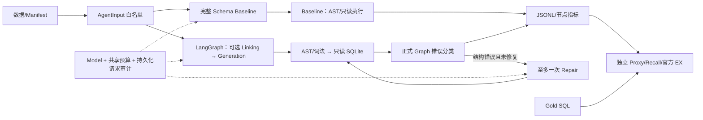

# 可审计的 Text-to-SQL Agent

## Vue 3 离线展示台（独立前端）

新增 `frontend/`：深浅主题、实验总览、SQL DEMO 回放、Vue Flow 工作流、A/B 逐题对比、安全审计与项目介绍六页。前端不调用模型、不执行 SQL、不加载生产密钥或原始日志；C/D 仍未真实运行。

```powershell
Set-Location frontend
npm install
npm run dev
# http://127.0.0.1:5173
# 验证：npm run build / npm run type-check / npm run lint / npm run test
```

Node.js 24.11.0 / npm 11.6.1；首次安装依赖需访问 npm registry。详见 [前端手册](frontend/README.md)、[设计](docs/FRONTEND_DESIGN.md) 和 [实际验收](docs/FRONTEND_STATUS.md)。Python CLI 与安全执行逻辑保持原样。

使用 Python、LangGraph 和真实 SQLite，把自然语言问题、Evidence、Schema 转成受安全校验的 SQL，并独立评测结果。项目重点是可比较的实验、只读执行、Gold 隔离、模型请求预算及崩溃审计。

这是已有 Python 项目的增量实现，当前是本地 CLI 与实验平台。已完成真实 Baseline、Schema-only A/B 和独立 Repair 诊断；**正式 C/D 尚未运行，没有完整 500 题成绩，也没有证明自然 Repair 提升官方 EX**。

## 已核验的真实成果

固定经典 BIRD Mini-Dev 33 题、11 个数据库，模型 deepseek-4.1-flash，LunaRoute，Evidence 开启、temperature=0、2048 输出 Token 上限、零自动重试、串行。

| 指标 | A Baseline | B Schema-only |
| --- | ---: | ---: |
| HTTP 请求尝试 | 33 | 66 |
| SQL 生成 / 执行成功 | 31/33 / 31/33 | 33/33 / 33/33 |
| 官方 EX（固定 33 题分母） | **19/33，57.58%** | **18/33，54.55%** |
| Local Proxy 匹配 / 固定分母 | 19/33 | 18/33 |
| 总 Tokens | **45,773** | **84,432** |
| 每题 Agent 平均延迟 | **8.201 秒** | **45.007 秒** |

B 表 Recall 68/68、字段 Recall 163/165，Schema 字符压缩 78.04%。Generator 输入 Tokens 减少 64.48%，但加上 Linking 开销后整体 Tokens 增加 84.46%，EX 少 1 题。此为小样本观察，不作统计显著性或一般因果结论；实际费用无账单依据，保持 UNKNOWN。

独立 Repair Diagnostic V1：8 次真实 Repair 请求，8/8 安全执行及预设语义断言通过。案例为手写结构错误，**不属于 BIRD 官方 EX**。A/B 共 66 条自然轨迹中，Repair 可触发错误为 0；64 条已生成 SQL 只读复验成功。历史未保存的执行结果行无法恢复，复验另存记录。

## 架构与边界



- Baseline 保留直接函数入口；schema_only、repair_only、full 共用显式 State 的受控 Graph。旧 graph 为兼容入口，不是正式消融路径。
- 图中的分类/Repair 分支仅在显式开启 Repair 时使用；schema_only 直接执行原 AST/只读路径，Baseline 不进入 Graph。
- Linking 校验真实表列，补全 PK/FK/桥接关系，非法选择回退完整 Schema。
- Repair 只接受安全的语法、缺表、缺列和歧义列错误；成功执行的业务错误、length、超时和危险 SQL 不触发修复。
- 所有生成和修复 SQL 都经过单语句 AST、mode=ro、query_only、authorizer 和时间/行数/字节限额。
- HTTP 请求前必须 ATTEMPT_PREPARED → flush/fsync，失败及未知结局占预算。日志失败阻止请求，SDK 重试及重定向关闭；不自动重放、不覆盖历史输出，不承诺 Exactly-Once。
- Gold 只用于独立评估，不进入生成/筛选/修复的 Prompt、State 或工具返回。
- 当前 Graph 直接调用本地 Python 工具；已有 stdio MCP Server，**尚无真实 MCP Client 集成**。未部署生产服务、前端或分布式 Agent。

核心实现：`bird_starter/data.py`、`baseline.py`、`schema_linking.py`、`schema_workflow.py`、`sql_repair.py`、`model.py`、`request_audit.py`、`tools.py`。官方评测为独立的 `official_ex_inputs.py` / `official_ex_windows.py`。

## 安装与本地数据

已验证 Windows + Python 3.13.5，使用项目 `.venv/Scripts/python.exe` 和 pwsh（PowerShell 7）。依赖在 requirements.txt；官方 EX 可选依赖单独放 requirements-eval.txt。现有 .venv 不重建。离线安装、精确版本快照和故障排查见 [复现手册](docs/REPRODUCIBILITY_GUIDE.md)。

```powershell
# 正式发布后可从目标仓库获取；已有工作区不重复克隆。
# git clone https://github.com/pcwl22/Text-to-SQL-Agent.git
# Set-Location Text-to-SQL-Agent
# 在已克隆的仓库根目录运行下列命令。
$ProjectPython = Join-Path $PWD '.venv/Scripts/python.exe'
& $ProjectPython -c 'import sys; print(sys.executable); print(sys.version.split()[0])'
& $ProjectPython -m pip check
# 仅全新环境安装；以下只获取依赖，不调用模型，现有 .venv 不重建：
# py -3.13 -m venv .venv
# & $ProjectPython -m pip install -r requirements.txt
# 官方离线评分可选：& $ProjectPython -m pip install -r requirements-eval.txt
# 无网络时使用预先准备的本地 wheelhouse：
# & $ProjectPython -m pip install --no-index --find-links .\wheelhouse `
#   -r requirements.txt -r requirements-eval.txt
```

用户另行准备真实 BIRD 数据，项目不包含数据库二进制或 Gold 数据文件。当前本地布局：

```text
data/mini_dev_data/mini_dev_sqlite.json
data/minidev/MINIDEV/dev_databases/<db_id>/<db_id>.sqlite
configs/phase3a/bird_dev33_v1.json
```

题库固定 500 题，JSON SHA256 `88ceb0710163cae46a256ecea8f0a8c98286599530b60587fda5c3cfe57d45d2`，官方 revision `f65faf4ae3b638c1fa6df1d3370c8d92c8366301`。Manifest SHA256 `7136f72aa9e0b78ccab8b29dfb077247a082e541604b4f8841fede2a63ba6dd8`。配置使用 pathlib，业务代码不硬编码 E 盘；文档命令均从当前仓库根目录解析路径。

```powershell
$env:PYTHON_DOTENV_DISABLED='1'
$env:LANGSMITH_TRACING='false'
$env:LANGCHAIN_TRACING_V2='false'
$env:BIRD_CASES_PATH=Join-Path $PWD 'data/mini_dev_data/mini_dev_sqlite.json'
$env:BIRD_DB_ROOT=Join-Path $PWD 'data/minidev/MINIDEV/dev_databases'
& $ProjectPython scripts/validate_bird_data.py --cases $env:BIRD_CASES_PATH --db-root $env:BIRD_DB_ROOT
```

预期 500/500 题目与 11 库匹配。CLI 参数优先于环境变量，环境变量优先于旧默认目录。不要因旧默认 data/mini_dev_data/dev_databases 不存在而重复下载或移动现有原库。数据来源、表数量、版本兼容和限制见 [DATA_PREPARATION.md](docs/DATA_PREPARATION.md)。

## 项目目录

```text
bird_starter/       Baseline、受控 Graph、安全 SQL、审计与独立评估
scripts/            数据验证、离线 Dry Run、结果导出与官方评分入口
tests/              默认离线单测及显式启用的真实库 + Mock 集成
configs/            固定参数、题目清单、Schema 元数据与公开证据哈希
docs/               审核后的技术报告、复现手册、作品集和许可说明
run_eval.py         原始 CLI 兼容入口
requirements*.txt  核心和可选官方评测依赖
```

data/、downloads/、outputs/、虚拟环境、生产 .env 和历史调试文档不随公开提交分发。源码克隆默认只运行合成夹具测试；真实数据由使用者另行取得。

## 零模型请求运行

```powershell
$DryOutput='outputs/readme_dry_' + [guid]::NewGuid().ToString('N')
& $ProjectPython scripts/run_ablation.py --groups A B --dry-run `
  --cases $env:BIRD_CASES_PATH --db-root $env:BIRD_DB_ROOT --out-dir $DryOutput
```

输出各 33 条 dry_run_ok，模型调用和请求预约均为 0，不生成 SQL。输出必须全新；存在时停止，不删除旧实验重跑。任何未来真实请求都需要新的明确授权，`.env` 存在不等于授权；本 README 没有可执行的真实模型命令。

模型入口支持根目录 dotenv override=False；显式 CLI 模型/URL 优先，既有环境值先于 `.env`，OPENAI 配置名与 DEEPSEEK 别名有回退关系。不要打印 `.env` 或密钥、不要将其提交；真实运行前必须核验最终解析配置和 shell 覆盖。本轮所有复现均离线。

## 测试与官方离线评分

```powershell
Remove-Item Env:PYTHON_DOTENV_DISABLED -ErrorAction SilentlyContinue
$env:PYTEST_DEBUG_TEMPROOT=Join-Path $PWD 'outputs/phase2_test_tmp'
New-Item -ItemType Directory -Force -Path $env:PYTEST_DEBUG_TEMPROOT | Out-Null
$env:BIRD_RUN_INTEGRATION='0'
& $ProjectPython -m pytest -q -rs --tb=short
& $ProjectPython -m compileall bird_starter run_eval.py
```

当前完整套件为 604 项。Windows/pwsh 与可选评测依赖已准备但没有官方源码缓存的公开副本，本轮默认离线结果为 577 passed、27 skipped：8 项真实数据集成加 19 项依赖本地官方源码缓存的评测器测试。已有缓存时默认可运行 596 项、仅跳过 8 项集成；数据和缓存齐备且显式启用后，本轮完整验证为 604 passed、0 skipped。测试收集前清除继承认证变量、临时 dotenv 隔离并禁止网络；移除 PYTHON_DOTENV_DISABLED 是为了测试 fake dotenv，不加载生产密钥。准确命令及独占报告目录配置见复现手册。

官方 EX 已完成 Windows 适配：固定官方 commit `abd11b6db92a1c9f809b32f7564c7c71b34d67f0`，保留评分逻辑，使用 SQLite 私有副本、只读连接、spawn 子进程及硬超时。Gold 控制 33/33、错误/缺失各 32/33，只证明评测器，不是模型成绩。A/B 采用固定完整性协议、失败/缺失/超时/结果截断计零，分母始终 33。Proxy 的行多重集比较不替代官方 EX。

已有 SQL 的重新导出、官方离线重评、逐题报告与诊断核查都无需模型 API，见 [REPRODUCIBILITY_GUIDE.md](docs/REPRODUCIBILITY_GUIDE.md)。报告器某些历史 pending 字段保留原样，官方分数读取独立 official_ex/summary.json，不回填或覆盖生成 Summary。

## 查阅成果与原始证据

新增实验可观测性与离线错误分析：新消融记录保存完整合法表列、实际筛选 Schema、回退原因、Prompt 版本和源码指纹，Baseline 增加节点指标。`scripts/analyze_errors.py` 可关联已有官方评分，分类生成/结果截断及待归因语义错误，无需模型或 SQL 执行；历史缺失的列投影保持 UNKNOWN。记录格式、零请求命令和人工归因接口见 [可观测性手册](docs/OBSERVABILITY.md)。本项补强不产生新的模型成绩。

P1A 新增默认关闭的实验性 Adaptive Schema Gate：显式启用后，仅在 Schema-only 中依据完整 Schema 的 UTF-8 字节数决定是否跳过 Linking。`scripts/analyze_schema_cost.py` 提供固定 33 题的零模型请求预检与成本估算；它没有 live 选项，不能据此给 Adaptive 填写官方 EX、实际延迟或费用。阈值依据、使用方法及验收见 [P1A 离线成本优化](docs/SCHEMA_COST_OPTIMIZATION_STATUS.md)。

| 材料 | 内容 |
| --- | --- |
| [FINAL_TECHNICAL_REPORT.md](docs/FINAL_TECHNICAL_REPORT.md) | 架构、数据、安全、审计、官方评分、真实结果、成本和限制 |
| [REPRODUCIBILITY_GUIDE.md](docs/REPRODUCIBILITY_GUIDE.md) | 从环境到无 API 验证的 PowerShell 步骤 |
| [PROJECT_CASE_STUDY.md](docs/PROJECT_CASE_STUDY.md) | 面试展示、技术取舍及可使用的作品集表述 |
| [A/B 归因摘要](docs/EXPERIMENT_RESULTS.md) | case 1317 分级归因、漏召回、Token/延迟分阶段分析 |
| [独立诊断结果](docs/EXPERIMENT_RESULTS.md) | 独立真实诊断 8/8、请求审计及适用边界 |
| [PHASE3C_REPAIR_DECISION.md](docs/PHASE3C_REPAIR_DECISION.md) | 历史自然路由 0、测试覆盖解释及暂缓 C/D 的依据 |

原始本地产物在 ignored outputs 下，公开源码副本可能不含这些私有文件：

- A：`outputs/phase3c_live/A_v1/`，Run ID `343c45833caa427c892f7a7887a29daf`。
- B：`outputs/phase3c_live/B_v1/`，Run ID `0529e0de668a4b3aa6acad2cb6bcb6a2`。
- Repair：`outputs/repair_diagnostic_live/v1/`，Run ID `40d2955515ef45f7b5bcf573d3d43f42`。
- 本次文档交付与离线重评证据：`outputs/final_delivery_v1/`。

各阶段状态报告按记录时间保存，不因后续完成而重写旧实验。历史 V1 请求数仍 UNKNOWN。当前成果不包括正式 C/D、500 题官方成绩、自然 Repair 收益、供应商账单、统计显著性、真实 MCP Client 或生产级安全治理。后续可选工作必须另行明确范围与授权，[CODEX_PLAN.md](CODEX_PLAN.md) 的规划名称不代表当前完成或批准状态。


公开发布说明：本文件保留技术结论，但机器专用路径与私有状态文档链接已改为便携说明/公开摘要。原工作区文档备份和原始实验数据仍保留本地，不公开；当前仓库许可状态及来源见 [第三方与许可说明](docs/THIRD_PARTY_NOTICES.md)。
