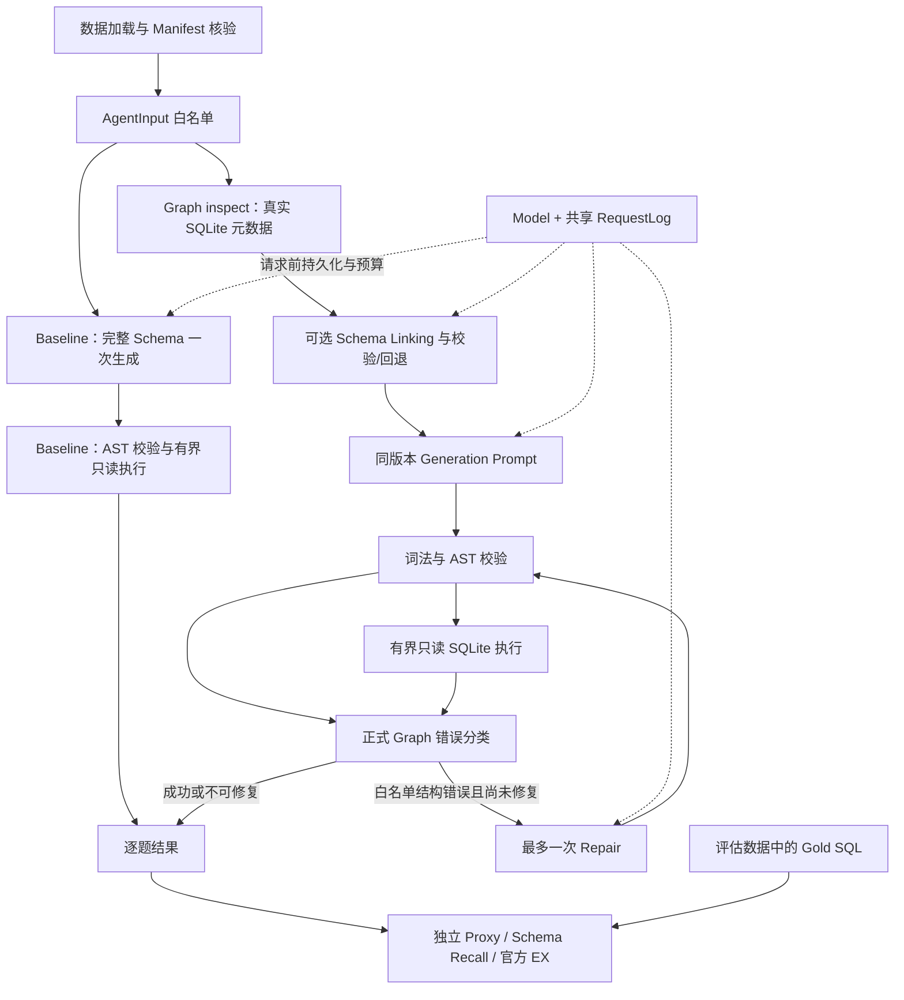

# Text-to-SQL Agent 技术报告

冻结日期：2026-10-22（Asia/Shanghai）。本报告整理已有实现与实测证据，不授予任何新模型调用权限，不宣布后续开发阶段已获批准。A/B 原始结果、独立 Repair 诊断和各阶段状态报告保持原样。

## 1. 背景与问题定义

目标是把自然语言问题、Evidence 和真实关系数据库 Schema 转换为一条可安全执行、可独立评测的 SQLite SELECT。工业场景的难点包括大 Schema 选择、跨表 JOIN、业务条件解释、SQL 结构错误、资源边界，以及外部模型请求在超时或崩溃后的计数与追溯。

工程成功与模型正确率分开验收：能执行不代表回答正确，Schema Recall 不代表 EX，Mock 错误注入不代表真实修复能力。本项目优先构建可观测、有限预算、默认离线的实验系统，再用固定样本检验设计是否有效。没有部署生产服务或宣称企业级沙箱隔离。

## 2. 数据集与 SQLite 层

经典 BIRD Mini-Dev SQLite：500 道真实题、11 个数据库。题目位于 `data/mini_dev_data/mini_dev_sqlite.json`，数据库位于 `data/minidev/MINIDEV/dev_databases/<db_id>/<db_id>.sqlite`；可选 CSV 描述不构成额外模型知识来源。

- 题目来源：官方 [birdsql/bird_mini_dev 固定 revision](https://huggingface.co/datasets/birdsql/bird_mini_dev/tree/f65faf4ae3b638c1fa6df1d3370c8d92c8366301)，revision `f65faf4ae3b638c1fa6df1d3370c8d92c8366301`。
- JSON SHA256：`88ceb0710163cae46a256ecea8f0a8c98286599530b60587fda5c3cfe57d45d2`。
- SQLite 为用户从官方 Mini-Dev 包下载的本地数据，11 库共 1,493,287,936 字节。项目固定本地 SHA256；没有独立官方库 checksum，不能把本地指纹当成上游认证。
- `bird_starter/data.py` 保留 load_cases/find_db；pathlib 处理路径，CLI > BIRD 路径环境变量 > 项目默认布局。字段/ID、JSON、数据库缺失/损坏及只读连接失败有明确错误。
- `scripts/validate_dataset.py` / `validate_bird_data.py` 检查完整性和 Schema；Gold 的可选 EXPLAIN 兼容检查仅在离线评估侧，不执行生成模型。历史数据验收为 500/500 映射、11 库完整性通过，详见 [DATA_PREPARATION.md](DATA_PREPARATION.md)。

正式 A/B 使用 `configs/phase3a/bird_dev33_v1.json`：每库 3 题、每种难度各 11 题，固定顺序。Manifest SHA256 为 `7136f72aa9e0b78ccab8b29dfb077247a082e541604b4f8841fede2a63ba6dd8`。这是版本化开发子集，不是完整 500 题成绩，也不是独立未观察测试集。

## 3. 最终运行架构与 Baseline

Baseline 是 `bird_starter/baseline.py` 的直接函数流程，入口 `run_eval.py --mode baseline`；完整 DDL 来自原 SQLite catalog，模板 `bird_starter/prompts.py` 的 `baseline-v1`。只生成一次 SQL，没有 Schema Linking、Repair 或重采样。图中 validate/classify/repair 分支仅在正式 Graph 显式启用 Repair 时使用；schema_only 生成后直接调用原 AST/只读执行器。正式实验额外由 `scripts/run_ablation.py` 固定配置、样本与输出身份。

Phase 2 V3 Run ID `eaf5d4877d3c44ba95b4a3846318b72f` 是 10 题历史烟测：10/10 生成及执行、Local Proxy 8/10。它不是 A 组 33 题，也没有用来填补 A/B 预测。证据：[EXPERIMENT_RESULTS.md](EXPERIMENT_RESULTS.md)。

## 4. LangGraph Schema Linking

正式共享图为 `bird_starter/schema_workflow.py` 的 build_schema_graph，数据契约与投影在 `schema_linking.py`。显式 State 保存 full_schema、chosen_schema、selection、节点指标和 trace；输入仅 question/evidence/db_path/mode，完整原 Schema 不改写。

Linking 输出应用层 JSON 契约：表、列、可选 JOIN 端点。逐项对照真实 SQLite 元数据，拒绝未知/重复字段、非法结构和不合法关系；补全主键、外键端点、所选表的桥接路径及既定闭包。失败按冻结策略回退完整 Schema。Generator 只收到验证后的 Schema，不能根据 Gold 做筛选。结构化 JSON 校验不等于供应商强制 JSON Schema 模式。

记录选择合法率、回退、表列 Recall、Schema 字符长度/估算 Token、模型真实 Usage 和节点耗时。Recall 在独立 `schema_evaluation.py` 使用 SQL AST/scope 处理别名、CTE 和 JOIN；无法可靠解析时保留 UNKNOWN，不用字符串命中率冒充 Recall。设计证据：[技术报告](FINAL_TECHNICAL_REPORT.md)、[架构与验收汇总](FINAL_TECHNICAL_REPORT.md)。后者是当时离线状态，不覆盖随后 B 组真实实验。

## 5. SQL Self-Correction

Phase 3B 增量加入 validate → execute → classify → optional repair；与 Linking 开关独立。`sql_repair.py` 的 `sql-repair-v1` 与诊断运行器共用。白名单仅 syntax、missing_table、missing_column、ambiguous_column；综合异常类型、SQLite 主错误码、完整锚定诊断和安全 AST 判定，未知错误保守拒绝。

每题最多一次 Repair，保留 original/current/repaired_sql 与 initial/final execution_history。修复 SQL 重新经过同一安全门及执行器，不绕过检查。危险 SQL、权限、超时、资源、模型/审计错误或执行成功均不触发修复；业务答案错误不能从 Gold/EX 反馈给节点。Repair Prompt 仅含问题、Evidence、验证 Schema、原候选 SQL 和固定错误枚举，不转发原生异常文本或结果行。

`repair_attempts`（进入节点）与实际 HTTP 调用分开：预算/审计可在发送前阻止请求。执行恢复与语义正确性分开统计。受控实验使用 schema_only/repair_only/full；`workflow.py` 的早期 legacy graph 为兼容入口，未用作冻结 A/B 或正式 Repair 诊断，不把它的旧实现描述成新受控契约。证据：[SQL Repair 架构](FINAL_TECHNICAL_REPORT.md)、[受控修复设计](FINAL_TECHNICAL_REPORT.md)。

## 6. 确定性安全层与 Gold 隔离

`tools.py` 限制单条 SELECT/CTE/集合查询，sqlglot AST 拒绝 DML/DDL/PRAGMA/ATTACH、危险函数及外部 Schema。正式 Repair 另用 tokenizer 词法门，在 AST 失败前拒绝危险内容。所有执行使用 SQLite URI mode=ro、query_only=ON、authorizer、时间/行数/结果字节与 SQL 长度限制；扩展和外部数据库连接禁止。

生成端先将完整数据记录投影为 AgentInput 白名单，不把 BIRD 的 SQL 字段传入 Prompt、State、工具或 Repair。独立 evaluator 才使用 Gold 表达式做 Proxy/Recall/EX。诊断的手写参考 SQL 和语义断言也只在评估侧使用。安全和隔离是程序契约，有独立 Mock/真实只读库测试，不依赖模型口头承诺。

这些限制不是完整 OS 隔离、多租户访问控制或生产数据治理；只读仍可能读取敏感行，若面向企业数据库，还需独立授权、行列权限与操作系统级资源隔离。本轮不实现这些后续能力。当前 LangGraph 直接调用本地 Python 工具，存在 stdio MCP Server，但没有真正的 MCP Client 传输集成；不能宣称 Agent 已通过 MCP 调用。

## 7. 请求预算、持久化与恢复

`model.py` 复用 OpenAI 兼容 SDK，正式配置 SDK/app 重试 0、重定向关闭、串行。请求数包含失败与未知结局；多个节点共享同一 Model/TrackedModel/RequestLog，不按成功响应预算。

`request_audit.py` 独占创建输出；每次 ATTEMPT_PREPARED 写入唯一 attempt_id、run/case/model/序号和时间，write/flush/fsync 成功后才调用 SDK，之后追加 SUCCEEDED/FAILED/INDETERMINATE。日志失败禁止后续请求。结果 JSONL 独立持久化，可与节点 attempt_id 对账；日志只存非敏感响应元数据、状态、Usage、Request ID，不保存密钥、认证头或完整 Prompt。

PREPARED 只是预算预约，不证明发出或计费。崩溃后未完成尝试保守占预算，不自动补发；既有路径不能续跑或覆盖，重新请求需要新的授权与输出目录。不提供 Exactly-Once 承诺。历史 V1 `017d25c18ccf4316a4a3984eabe1c840` 的 HTTP 数继续 UNKNOWN，不能由新日志机制倒推。根目录 dotenv 使用 override=False；离线验收隔离生产凭据，不能把当前 shell 覆盖优先级忽略。证据：[请求持久化与恢复](FINAL_TECHNICAL_REPORT.md)。

## 8. 官方 BIRD EX 的 Windows 适配

来源 [bird-bench/mini_dev](https://github.com/bird-bench/mini_dev/tree/abd11b6db92a1c9f809b32f7564c7c71b34d67f0)，commit `abd11b6db92a1c9f809b32f7564c7c71b34d67f0`。`configs/official_ex/upstream.json` 固定 evaluation_ex.py / evaluation_utils.py SHA256：

- `da1bbcd4530be83692d7c650c814ea9704bb710d0c953eb75d02ccb38233cf89`
- `f6943d249caac5aeaef9bce21d43dbf29dcef85a0c965a76df032a9542f308bf`

原文件位于 ignored 本地 cache，不修改官方结果匹配逻辑。官方使用结果行集合比较；项目 Local Proxy 采用行多重集且有截断/完整性规则，二者独立报告，即使本次数值相同也不混用。

独立 exporter 验证长度、顺序、case_id/db_id、Manifest/数据指纹及审计关联，拒绝 zip 静默截断。失败、缺失、超时或不完整 Agent 结果在实验前固定协议 `complete-agent-results-only-failed-zero-v1` 下置零，分母固定 33。它是带 Agent 完整性条件的子集官方评分，不等同于放开本地限额后任意重跑原 SQL。Agent SQL 限时 8 秒/1000 行；官方评分 SQL 限时 30 秒，worker 硬限时 40 秒，整批默认硬限时 1500 秒。

`official_ex_windows.py` 用 Windows spawn/入口保护及 freeze_support，独立 CLI 子进程、单 worker 顺序执行、Windows Job Object 清理进程树。先复制数据库到新私有目录，再以只读/authorizer 连接；连接 SQLite 的兼容包装禁止外部服务和扩展。官方 func_timeout 在单次 SQLite 比较边界由进程/VM 超时替代，上游比较函数未改写。运行前后核对原库与副本 SHA256，正常结束仅清理本次副本。依赖独立于生产 requirements，见 requirements-eval.txt。

Gold-vs-Gold 33/33、无效预测/缺失预测各 32/33 是评测器控制，不是模型准确率。完整补丁边界、测试和风险：[OFFICIAL_EX_PROTOCOL.md](OFFICIAL_EX_PROTOCOL.md)、[Windows EX 协议](OFFICIAL_EX_PROTOCOL.md)。

## 9. A/B 真实消融设计与结果

统一配置 `configs/phase3c/ablation_v1.json`：LunaRoute / `https://gw.lunaroute.com/v1` / deepseek-4.1-flash，temperature=0、n=1、max_completion_tokens=2048、请求超时 300 秒、Evidence 开启、重试 0、串行、同 Generator 模板/执行器/评分协议。A 不筛选不修复；B 仅开启 Schema Linking。独立 Run ID 和目录，固定 33 题；不根据结果更换样本或 Prompt。

| 指标 | A Baseline | B Schema-only |
| --- | --- | --- |
| Run ID | `343c45833caa427c892f7a7887a29daf` | `0529e0de668a4b3aa6acad2cb6bcb6a2` |
| 原始目录 | outputs/phase3c_live/A_v1 | outputs/phase3c_live/B_v1 |
| HTTP 尝试 | 33 | 66 |
| 有效 SQL 生成 / 执行 | 31/33 / 31/33 | 33/33 / 33/33 |
| 官方 EX（固定 33 分母） | **19/33，57.58%** | **18/33，54.55%** |
| Local Proxy 匹配 / 固定分母 | 19/33 | 18/33 |
| Prompt / Completion Tokens | 30,485 / 15,288 | 60,465 / 23,967 |
| 总 Tokens | **45,773** | **84,432** |
| 每题 Agent 延迟 mean/P50/P95（秒） | **8.201 / 5.806 / 18.875** | **45.007 / 39.663 / 87.310** |
| Schema 表 / 字段 Recall | 完整 Schema 对照 | **68/68 / 163/165** |
| 原始选择合法率 / 回退 | 不适用 | 32/33 / case 195 回退 1 次 |
| 字符长度加权 Schema 压缩率 | 0 | 78.04% |
| Repair 请求 | 0 | 0 |

延迟来自逐题 total_latency_ms，不是纯模型延迟或实验整批墙钟时间；分位数沿用线性插值。A 的两次 length（94、198）不进入 SQL 执行且不补跑；结果截断 A 的 340、B 的 28/340 按固定协议计零。全部 Usage 已返回；实际费用 UNKNOWN，无供应商账单或核验单价。

逐题配对：18 题双方正确、14 题双方错误、1 题仅 A 正确（1317）、0 题仅 B 正确。观察差为 -1/33，即 -3.03 个百分点；没有统计显著性结论，不把生成率提高当成准确率提高。原始官方分数来自各组 official_ex/summary.json，原生成 Summary 中 official_ex=null 不被回填。原报告：[A/B 公开结果](EXPERIMENT_RESULTS.md)、[A/B 公开结果](EXPERIMENT_RESULTS.md)。

## 10. 独立 Repair 真实诊断

计划 `configs/phase3c/repair_diagnostic_v1.json`，SHA256 `b4c0e16cb01d38505de7667595057f29b521e824aaffc2fd7ad5cad75e7fe8ca`。RD01–RD08 为依据真实 Schema 独立手写的 8 例，4 类结构错误各 2 个、覆盖 8 库；没有从 Gold 或 A/B 错题生成错误 SQL。

Run ID `40d2955515ef45f7b5bcf573d3d43f42`，目录 `outputs/repair_diagnostic_live/v1`：8 次真实 Repair HTTP 200，8/8 响应有效、安全、执行及冻结语义断言通过，重试 0。共 7,386 Prompt + 462 Completion = 7,848 Tokens；模型延迟平均/P50/P95 为 27.280/29.449/42.962 秒，费用 UNKNOWN。共用正式 Repair Prompt/Model/审计/安全层，无 Generator 或 Linking。4 个不可修复负例只有离线拒绝控制、0 请求。

语义断言是完整单行计数、参考结果、指定表与 COUNT/DISTINCT 的预定义检查，不是通用 SQL 等价证明。样本刻意简单且有明确技术意图，8/8 不能称为 BIRD EX 100% 或复杂业务语义修复率。原始记录未保存执行结果具体行；后续只读复验另存 17686/56822/91966/32461/4500/954/28/343，与冻结参考一致，不伪称恢复历史行值。证据：[独立诊断结果](EXPERIMENT_RESULTS.md)。

## 11. Case 1317：分级归因

问题询问参加 Women's Soccer 且需要 Medium T-shirt 的学生人数，Evidence 明确事件名与尺码。A/B 的 JOIN、COUNT DISTINCT、事件和尺码条件一致；B 额外加入 `member.position = 'Student_Club'`。

- **CONFIRMED**：原 SQL 的独立只读重执行得到 A=7、B=0；仅移除 B 的额外谓词得到 7。该谓词造成本地结果差异。该题表/字段依赖 Recall 均完整，不属于两处字段漏召回。
- **LIKELY**：生成器可能将问题中的 “from the Student_Club” 解读为 position 字面值条件，Evidence 没有给出这个映射。
- **UNKNOWN**：模型为何添加谓词；Schema 缩减、供应商波动各贡献多少；同一次调用使用完整 Schema 的反事实响应。历史原始 Linking JSON、精确列投影和完整筛选 DDL 未保存，不能从哈希恢复。

因此“B 该题退步”不自动等于“Schema Linking 导致错误”。两处字段未召回在 case 5 的 schools.School 和 28 的 schools.DOC：前者仍 EX=1；后者结果截断且使用 DOCType，不能确证缺失字段是充分原因。case 195 按 invalid_contract 回退完整 Schema 后 EX=1，具体非法字段历史不可获得。证据：[A/B 归因摘要](EXPERIMENT_RESULTS.md)。

## 12. Token、延迟与工程成本

| B 节点 | Prompt Tokens | Completion Tokens | 合计 |
| --- | ---: | ---: | ---: |
| Schema Linking | 49,636 | 11,716 | 61,352 |
| SQL Generator | 10,829 | 12,251 | 23,080 |

B Generator 输入比 A 少 19,656 Tokens（64.48%），Generator 合计节省 22,693；但 Linking 自身消耗 61,352，整批净增 **38,659 Tokens（84.46%）**。78.04% 的 Schema 字符压缩率不等于实际输入 Token 降幅；完整 Prompt 还有系统消息、问题、Evidence、关系说明，字符与 tokenizer 不等价。

B 平均 Linking 20.718 秒、Generator 24.254 秒，平均非模型计时残差 35.139 毫秒；残差包括本地执行/编排，不是纯 CPU 时间。不能将分位数直接相减或把单次供应商延迟差异归因于 Prompt 大小。请求审计 fsync、独立评分 worker 和数据库副本增加工程成本，但换取可追溯与原库保护；这些成本不与模型费用混算。

## 13. 限制、决策与后续可选工作

已有 A/B 66 条真实轨迹中，可修复结构错误 **0**，length 2、结果截断 3、完整执行但官方不匹配 24。64 条已生成 SQL 只读复验成功；0/66 是历史轨迹路由观察，不证明未来独立生成也没有 Repair 机会。人工诊断说明能力，自然轨迹说明机会，二者不能合并。

C/D **尚未真实运行**；没有完整四组真实消融、完整 500 题成绩、自然 Repair 端到端收益、账单费用或显著性结论。独立完成 C≤66、D≤99 次新 HTTP 尝试，合计上限 165，其中基础生成/筛选 99、最多额外 Repair 66。即使未来零 Repair，基础请求成本仍存在。

[PHASE3C_REPAIR_DECISION.md](PHASE3C_REPAIR_DECISION.md) 建议保留阶段性成果、暂缓 C/D。若以后需要完整四组交付，再在不改 Manifest/Prompt/协议的前提下独立授权；历史授权不延续。其它可选方向包括真实 MCP Client、企业权限/沙箱、外部分布验证或改进观测字段，均未在本轮开发或获自动批准。

## 交付与验收索引

当前新增本报告、[REPRODUCIBILITY_GUIDE.md](REPRODUCIBILITY_GUIDE.md)、[PROJECT_CASE_STUDY.md](PROJECT_CASE_STUDY.md)，更新项目 README；不改变业务代码和历史数据。各阶段旧“尚未运行”内容按其记录时间解释，不能覆盖本报告引用的后续原始证据。

本轮测试、离线 A/B 重评、官方控制及哈希校验结果统一保存在 `outputs/final_delivery_v1/`，以该目录最终 `final_acceptance.json` 为验收证据。离线重评生成独立新目录，不替换历史评分；控制实验和 Mock 结果不计入模型成绩。

| 本轮实际检查 | 实测结果 / 退出码 |
| --- | --- |
| 完整 pytest，BIRD_RUN_INTEGRATION=1 | **604 passed，0 failed/0 skipped，430.49 秒，exit 0** |
| 独立 bird_integration | **8 passed，596 deselected，0 failed/0 skipped，323.32 秒，exit 0** |
| tests/test_gold_isolation.py | **5 passed，1.90 秒，exit 0** |
| compileall bird_starter run_eval.py；compileall scripts；pip check | 全部 exit 0；No broken requirements found. |
| A/B Dry Run | 两组各 33 题，真实模型调用及预约均 0，exit 0 |
| 诊断 Dry Run | 8 正例检查、4 负例拒绝，模型调用及预约 0，exit 0 |
| A/B 新目录官方离线重评 | **19/33、18/33**；66 个逐题判定与历史一致，exit 0，无硬超时 |
| full/integration 各自的官方控制 | Gold 33/33、无效/缺失各 32/33；仅评测器控制 |
| 诊断原始 SQL 只读核验 | 8/8 冻结断言再次通过，与审计逐例一致，exit 0 |
| 历史/源码/数据指纹 | 337 项不变；README 为明确授权的文档更新，原版单独留档 |

首次辅助目录核对因 Windows Path 排序和字符串排序不同而失败；核查集合无增删、所有哈希一致后统一排序口径，复验通过。只修正本次 outputs 中的辅助脚本，没有修改生产源码、历史目录或旧指纹清单。文档凭据形式扫描与本地链接检查未发现问题；扫描不读取生产密钥，不等于外部泄露排查或密钥值枚举。

公开发布说明：本文件保留技术结论，但机器专用路径与私有状态文档链接已改为便携说明/公开摘要。原工作区文档备份和原始实验数据仍保留本地，不公开；当前仓库许可状态及来源见 [第三方与许可说明](THIRD_PARTY_NOTICES.md)。
